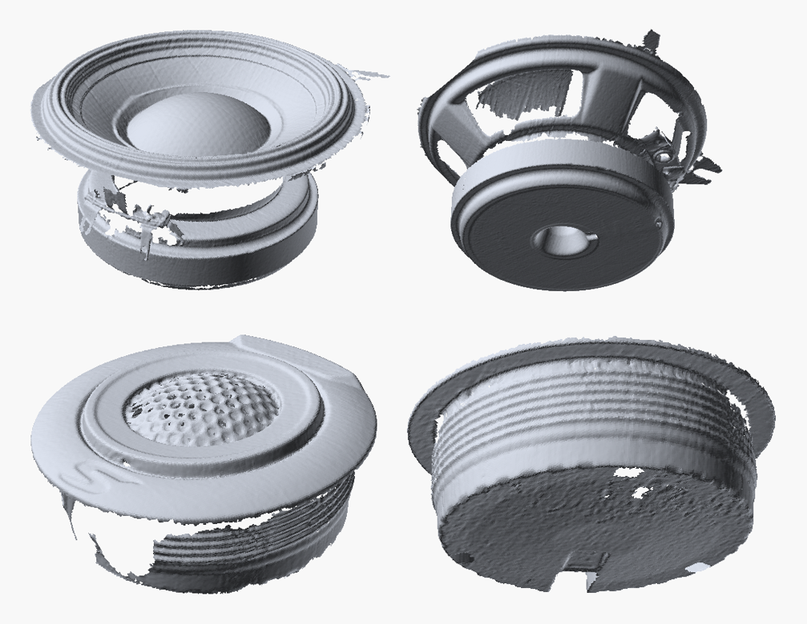
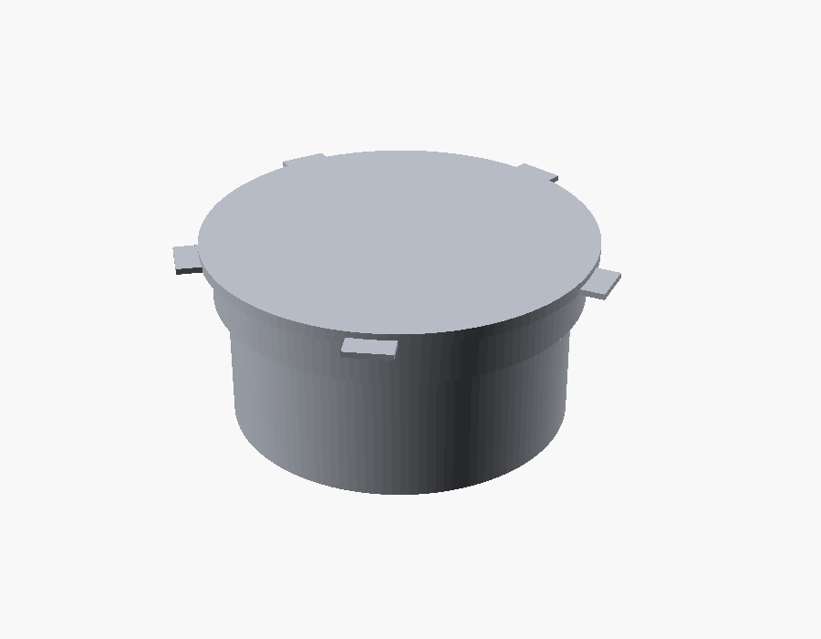

# Alpine S2-S40C 3D scans

3D scans of the drivers from an **Alpine S2-S40C** set: the 4" (10 cm) S-Series 2-way
component speaker set, with a 4" woofer and a separate dome tweeter. Use them to design
enclosures, pods, door and kick-panel adapters, dash mounts, grilles, and so on.

The scans were made with a Creality 3D scanner (CrealityScan). Each driver was scanned twice:

- **face-up:** the magnet on the table, which captures the front and the sides;
- **face-down:** the front on the table, which captures the back of the frame and the magnet.

The table has been cut away. The face-down pass has been registered onto the face-up pass, so
both halves share one coordinate frame.

## Coordinate frame

All files are in **millimetres**.

- The z axis is the driver's axis.
- **z = 0 is the mounting surface** (the back of the flange, where it sits on the baffle).
- +z points toward the front (the cone or dome); −z points toward the magnet.
- x and y are centred on the driver.

Drop a file into your CAD at the baffle's front face and it sits where the real driver would.

## Files

| File | What it is |
| --- | --- |
| `scans/alpine_s2-s40c_woofer_combined_scan.stl` | Woofer, both passes together (1.07 M triangles) |
| `scans/alpine_s2-s40c_woofer_faceup_scan.stl` | Woofer, front and sides |
| `scans/alpine_s2-s40c_woofer_facedown_scan.stl` | Woofer, back of the frame and the magnet |
| `scans/alpine_s2-s40c_tweeter_combined_scan.stl` | Tweeter, both passes together |
| `scans/alpine_s2-s40c_tweeter_faceup_scan.stl` | Tweeter, front (grille) and sides |
| `scans/alpine_s2-s40c_tweeter_facedown_scan.stl` | Tweeter, back and the cable exit |
| `clearance/alpine_s2-s40c_{woofer,tweeter}_clearance.stl` | Simple solid stand-ins sized from the scans, for boolean cuts and clearance checks |
| `clearance/clearance.scad` | OpenSCAD source of the clearance models |

The scan meshes are surface scans. They are **not watertight** and have holes where the scanner
couldn't see, such as under the woofer basket and around the terminals. For a solid you can
subtract from a model, use the clearance STLs.

## Measured dimensions

Measured from these scans, plus a few measurements taken by hand on the real drivers (noted).
Check them against your own drivers before you cut anything you can't redo.

**Woofer**
- Overall depth: 49 mm.
- 46 mm behind the mounting surface (measured by hand) and about 3 mm in front of it.
- Frame circle about 101 mm across. Five mounting ears reach about 113 mm across.
- Basket about 95 mm across just behind the flange. The motor is 87–88 mm across.
- Baffle cutout: **102 mm**. Four screw holes on a 112 mm circle at the diagonals (measured by
  hand).

**Tweeter** (it comes with its grille, so the scan is its final shape)
- 58 mm flange.
- 51–52 mm body; a 52 mm cutout fits.
- About 19 mm behind the mounting surface and about 7 mm in front of it.

The ears on the woofer clearance model are spaced evenly at an arbitrary angle. They aren't
matched to the scan's orientation.

## Notes

- There's some noise at the edges, for example small flecks around the woofer's ears and
  terminals.
- The tweeter's face-down pass includes the start of its cable.
- The woofer's terminals show up in the scan. Rotate the model to put them where you need them.

## Licence

[CC BY 4.0](https://creativecommons.org/licenses/by/4.0/). Use them for anything, including
commercial work; just credit this repository.

Alpine and S-Series are trademarks of Alpine Electronics. This project isn't affiliated with or
endorsed by Alpine. These are scans of retail drivers, made to help with fitting them.
